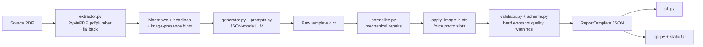

# PDF → JSON Template Translator

Turn a trades PDF (inspection report, estimate, invoice, compliance checklist,
work order) into a **valid GenerSwift `ReportTemplate` JSON (`schema_version: 3`)**
that JobDoc can consume without a second human-authoring pass for basic use.

This repository is a **prototype**. It is released under a **strict proprietary
license** — see [`LICENSE.md`](LICENSE.md). The previous README incorrectly
labeled it MIT; that was a metadata error, not a grant of rights.

## Problem

Field businesses already have static PDFs. JobDoc needs those documents as
**guided, voice-driven capture templates**: ordered sections, day-one worker
instructions, checkable success criteria, writer instructions, and photo slots.

Hand-building that JSON does not scale, and unconstrained LLM output is not a
contract. This tool treats translation as a **data pipeline with a hard schema
gate**: extract → generate → normalize → validate, and **never return an invalid
template**.

The only runtime contract with JobDoc is the isolated schema in
[`src/pdf_to_json/schema.py`](src/pdf_to_json/schema.py). There is no import of
the JobDoc / `report_automation` codebase.

Example PDFs and addresses in this repo are **synthetic fixtures**, not client
documents.

## Architecture



| Stage | Module | Role |
| ----- | ------ | ---- |
| Extract | `extractor.py` | PDF → hierarchical Markdown, page count, headings, image-presence metadata. Prefers PyMuPDF; falls back to pdfplumber. No OCR. |
| Generate | `generator.py`, `prompts.py` | Extracted text → template dict via JSON-mode chat completion. Completer is injectable so tests never call a network LLM. |
| Normalize | `normalize.py` | Repair mechanically-fixable LLM quirks (ranges, `capture_order`, severity aliases, empty phrases). `apply_image_hints()` forces `show_photo` / `image_placement` when the source heading had images. Does not invent sections. |
| Validate | `validator.py`, `schema.py` | Strict Pydantic v2 models plus 1:1 section mirroring. Quality issues are **warnings**, not rejects. |
| Orchestrate | `pipeline.py` | `extract → generate → normalize → validate`. Invalid output is an error. |
| Interfaces | `cli.py`, `api.py`, `static/index.html` | Typer CLI, FastAPI, and a same-origin browser UI. |

## Design trade-offs

These are deliberate, not leftovers:

- **Text extraction + LLM, not vision/OCR.** Native-text PDFs are the MVP. Scanned
  packets fail closed with a clear error instead of shipping a hallucinated
  template. Cost and ops stay small; the failure mode is honest.
- **Isolated schema copy, not a shared JobDoc package.** Decouples this tool from
  the product repo. Drift is a real risk: if JobDoc's gold schema changes, this
  copy must be updated by hand.
- **Normalize mechanical errors; do not auto-retry generation.** Out-of-range
  `max_images` should not discard an otherwise good template. Broken mirroring
  still fails. There is no "ask the model again" loop, so a bad generation is
  cheap and deterministic to debug.
- **Quality checks are warnings.** Thin `success_criteria` should not block a
  schema-valid template a human can edit in the UI. The prompt carries the
  quality bar; validation enforces the contract.
- **JSON mode Chat Completions, not structured-output / tool-calling.** One
  object, schema enforced after the fact. Simpler backend swap; weaker
  compile-time guarantees than a JSON Schema response format.
- **Default CORS `*`.** Convenient for a prototype UI. Production should pin
  `PDF_TO_JSON_CORS_ORIGINS`.
- **Always-on ASGI over serverless.** `vercel.json` caps `maxDuration` at 60s.
  LLM generation on large PDFs can exceed that. Prefer Docker / Render for
  anything beyond a demo.

## How to run

Requires **Python 3.11+**. No API key is needed for tests or the offline example.

```bash
python -m venv .venv
source .venv/bin/activate   # Windows: .venv\Scripts\activate

# Reproducible (what CI and Docker use)
pip install -r requirements-dev.txt
pip install -e . --no-deps

# Or, looser ranges from package metadata
# pip install -e ".[dev]"
```

```bash
cp .env.example .env
# Set OPENAI_API_KEY only if you will call the live generator.
```

`.env` is gitignored. Do not commit real keys.

### Tests and lint (offline)

```bash
ruff check src tests scripts api
python -m pytest
```

### Offline demo (no LLM)

```bash
python scripts/run_example.py
# writes examples/sample_output.json (validated)
pdf-to-json validate examples/sample_output.json
```

### CLI (live LLM)

```bash
pdf-to-json translate path/to/report.pdf --output template.json
pdf-to-json extract path/to/report.pdf          # no key needed
pdf-to-json validate template.json              # no key needed
```

### API / browser UI

```bash
uvicorn pdf_to_json.api:app --reload --port 8000
# http://localhost:8000/        UI
# GET  /health                  liveness + llm_configured
# GET  /schema                  output JSON Schema
# POST /translate               multipart field `file`
```

```bash
curl -s -F "file=@path/to/report.pdf" http://localhost:8000/translate
```

### Docker

```bash
docker build -t pdf-to-json .
docker run -p 8000:8000 -e OPENAI_API_KEY pdf-to-json
```

Pass the key via the environment or a secret store. Do not bake it into the image.

## Measured results

Only numbers produced by a named command on a named date. Anything else is
**not measured**.

| Claim | Result | Command | Date |
| ----- | ------ | ------- | ---- |
| Offline unit/integration tests | **74 passed** in 0.45s | `python -m pytest` (Python 3.12.3, pinned deps in `requirements-dev.txt`) | 2026-10-19 |
| Ruff (E, F, I, W) | **All checks passed** | `ruff check src tests scripts api` | 2026-10-19 |
| Live LLM translation quality (section recall, edit rate, JobDoc drop-in success) | **not measured** | — | — |
| Extraction quality on real client PDFs | **not measured** | — | — |
| End-to-end latency / token cost | **not measured** | — | — |
| Production uptime / error rate | **not measured** | — | — |

The 74-test figure is the offline suite (schema, validator, normalize, generator
sanitization, image hints, pipeline with a fake completer, API, committed
fixture). It does **not** exercise OpenAI.

## Known failure modes

- **Scanned or image-only PDFs.** No OCR. Extraction raises if usable text is
  missing (`< ~20` characters). `is_probably_scanned` is set on near-empty
  pdfplumber output.
- **Sparse or unusual PDFs.** The model may omit required fields or break
  section mirroring. The pipeline returns a validation error; it does not retry
  generation.
- **Malformed model JSON.** Fence-stripping and outermost `{...}` recovery are
  best-effort. Non-objects still fail.
- **Auth / model access.** HTTP 401 and missing-model 404 are mapped to a clear
  `GenerationError` and are **not** retried. Rate limits, timeouts, and 5xx are
  retried (tenacity, up to 3 attempts).
- **`/health` `llm_configured: true` only means a key is present**, not that
  OpenAI will accept it.
- **Image-to-heading association is a heuristic** (nearest preceding heading by
  page/y). Unassociated images exist; photo slots can be wrong on messy layouts.
- **Quality warnings are non-blocking.** A template can be schema-valid and
  still be a poor day-one workflow. Review before dropping into JobDoc.
- **Default CORS is `*`.** Fine for a local prototype; pin origins in production.
- **Vercel `maxDuration` is 60s** in `vercel.json`. Large PDFs + `gpt-4o` can
  time out. Use Docker/Render for reliable runs.
- **Schema drift vs JobDoc.** This repo owns a copy of `schema_version: 3`. If
  the product schema moves, output can validate here and fail there.
- **PII in source PDFs.** Uploaded documents are written to a temp file for the
  request and can be sent to the configured LLM provider. Do not put real client
  PDFs in this git repo. The committed example uses `100 Example Parkway`.

## Environment

| Variable | Default | Purpose |
| -------- | ------- | ------- |
| `OPENAI_API_KEY` | empty (required for live generate) | LLM access. Sanitize-on-read strips quotes / `Bearer ` / whitespace. |
| `PDF_TO_JSON_MODEL` | `gpt-4o` | JSON-mode-capable model. |
| `PDF_TO_JSON_TEMPERATURE` | `0.2` | Sampling temperature. |
| `PDF_TO_JSON_TIMEOUT` | `120` | LLM HTTP timeout (seconds). |
| `OPENAI_BASE_URL` | SDK default | Azure / proxy base URL. |
| `PORT` | `8000` | Bind port. |
| `PDF_TO_JSON_CORS_ORIGINS` | `*` | Comma-separated origins. |
| `PDF_TO_JSON_MAX_UPLOAD_MB` | `25` | Upload cap. |
| `PDF_TO_JSON_LOG_LEVEL` | `INFO` | Log verbosity. |

## Layout

```
src/pdf_to_json/     schema, extract, generate, normalize, validate, pipeline, CLI, API, UI
tests/               offline tests (no API key)
examples/            synthetic sample_output.json
scripts/run_example.py
.github/workflows/ci.yml    ruff + pytest on Python 3.11 and 3.12
requirements.txt            pinned runtime deps
requirements-dev.txt        pinned pytest / httpx / ruff
```

## License

Proprietary. See [`LICENSE.md`](LICENSE.md). No rights are granted by this
README.
